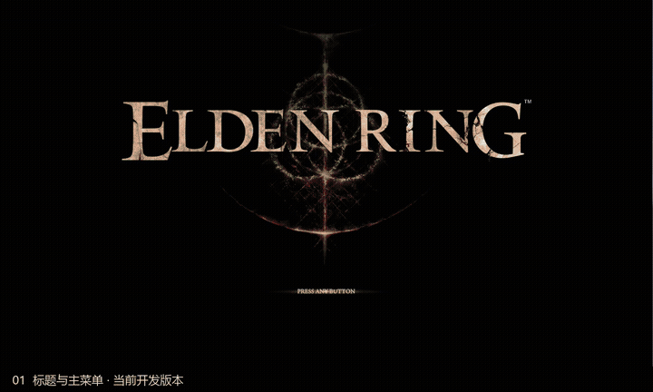

# Elden

使用 Unity 6 开发的第三人称动作 RPG，以《艾尔登法环》的战斗和界面为参考。目前可以创建角色，进入近林洞窟探索，与狼群和兽人 Boss 战斗。

[下载 Windows 版本](https://github.com/1716285375/Elden/releases/latest) · [构建工作流](https://github.com/1716285375/Elden/actions/workflows/windows-release.yml)



[查看游戏画面](Media/gameplay.jpg)

## 游戏内容

| 内容 | 功能 |
| --- | --- |
| 角色创建 | 10 种出身、男女体型、姓名、发型、肤色、眼睛与脸部细节调整 |
| 近战战斗 | 轻重攻击、连段、蓄力、翻滚、后撤、跳跃攻击、举盾、弹反、锁定与双手握持 |
| 装备与背包 | 模块化角色与护甲；武器、穿戴装备、物品各有独立入口，物品按类别管理 |
| 洞窟探索 | 近林洞窟、普通狼、精英狼、法姆·亚兹拉的兽人，以及赐福和 Boss 血条 |
| 菜单与存档 | 角色属性、系统设置、多槽位存档，以及角色外观和装备保存 |

项目仍在开发。地图缺面和角色穿落、部分动画与材质、赐福交互及加载卡顿仍需修复，界面也在继续调整。

## 开始游戏

1. 从 Releases 下载 `Elden-Windows.zip`。
2. 解压整个压缩包。
3. 运行 `Elden.exe`，保留同目录的 `Elden_Data` 等文件。

## 开发

项目使用 Unity 6000.3.11f1、URP、Input System、Netcode for GameObjects 和 AI Navigation。

美术资源只保留在本地。Windows Release 工作流由能访问完整工程的本地 runner 构建，发布可运行压缩包，不上传素材工程或开发记录。克隆源码后，需要自行补齐资源才能在编辑器中运行。

## 操作

| 操作 | 键鼠 | Xbox 手柄 |
| --- | --- | --- |
| 移动 / 视角 | WASD / 鼠标 | 左摇杆 / 右摇杆 |
| 翻滚 / 冲刺 | 轻按 / 长按空格 | 轻按 / 长按 B |
| 跳跃 / 蹲伏 | F / X | A / 左摇杆按下 |
| 轻攻击 / 防御 | 鼠标左键 / 右键 | RB / LB |
| 重攻击 / 战技 | Shift + 左键 / Shift + 右键 | RT / LT |
| 锁定 | Q / 鼠标中键 | 右摇杆按下 |
| 交互 / 使用道具 | E / R | Y / X |
| 切换左右手武器 | 方向键右 / 左 | 十字键右 / 左 |
| 切换快捷道具 | 方向键下 / 滚轮向下 | 十字键下 |
| 双手握持右 / 左武器 | 按住 E + 左 / 右键 | 按住 Y + RB / LB |
| 打开菜单 / 返回 | Esc / Q | Menu / B |

## 项目结构

```text
Assets/_Game/
  Scripts/     角色、战斗、AI、界面、存档与世界逻辑
  Data/        玩法配置、动画控制器与预制体
  Scenes/      标题与地图场景
  Editor/      资源导入、场景配置、录制与检查工具
  Tests/       EditMode / PlayMode 测试
```
